<p align="center">
  <picture>
    <source media="(prefers-color-scheme: dark)" srcset="docs/images/banner-dark.svg">
    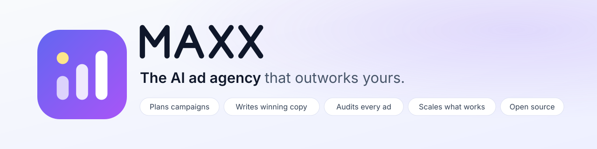
  </picture>
</p>

<p align="center">
  <b>Your entire ad team, in one open-source app.</b>
</p>

<p align="center">
  🚀 Builds complete Meta campaigns from a one-line brief<br>
  ✍️ Writes ad copy and scores every line before it runs<br>
  🔍 Audits your account every day and finds the wasted spend<br>
  📈 Shows what to scale, proven against your real sales<br>
  ⚡ Turns every recommendation into a one-click change<br>
  💬 Answers any ad question with the numbers to back it up
</p>

<p align="center">
  <a href="#quickstart">Quickstart</a> ·
  <a href="#what-maxx-can-do">Features</a> ·
  <a href="#see-it-work">See it work</a> ·
  <a href="docs/install.md">Install</a> ·
  <a href="#architecture">Architecture</a> ·
  <a href="#roadmap">Roadmap</a> ·
  <a href="#documentation">Docs</a>
</p>

<p align="center">
  <a href="https://github.com/geovannig1/maxx-ai-media-buyer/actions/workflows/ci.yml"></a>
  <a href="LICENSE"></a>
  
  
  
</p>

<p align="center">
  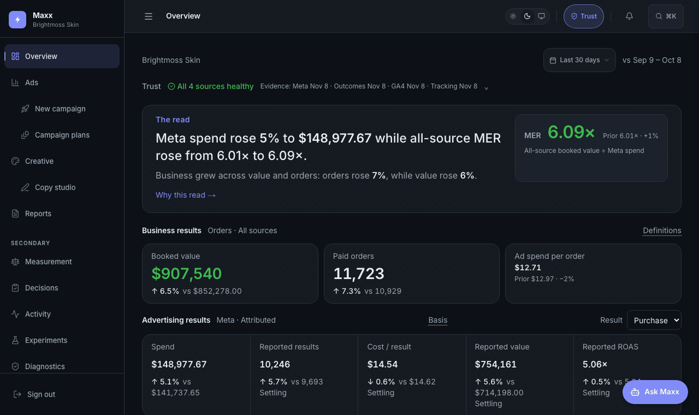
</p>

Maxx is a self-hosted AI ad agency for **Meta ads** and the answer to your ad questions: it drafts
complete campaigns, writes and scores the copy, audits the account and turns its recommendations into
changes you approve with one click. Every number comes from deterministic code over your synced ad
data and the sales, leads or bookings your business actually recorded, and names its source, window
and confidence. Campaigns are created **paused**, every write waits for your approval, and the AI is
optional.

> [!TIP]
> No accounts and no secrets needed to look around: `npm ci` then `npm run demo` opens the full
> console on sample data. See the [Quickstart](#quickstart).

## What Maxx can do

<table>
  <tr>
    <td width="50%" valign="top">
      <picture>
        <source media="(prefers-color-scheme: dark)" srcset="docs/images/campaign-plan-dark.webp">
        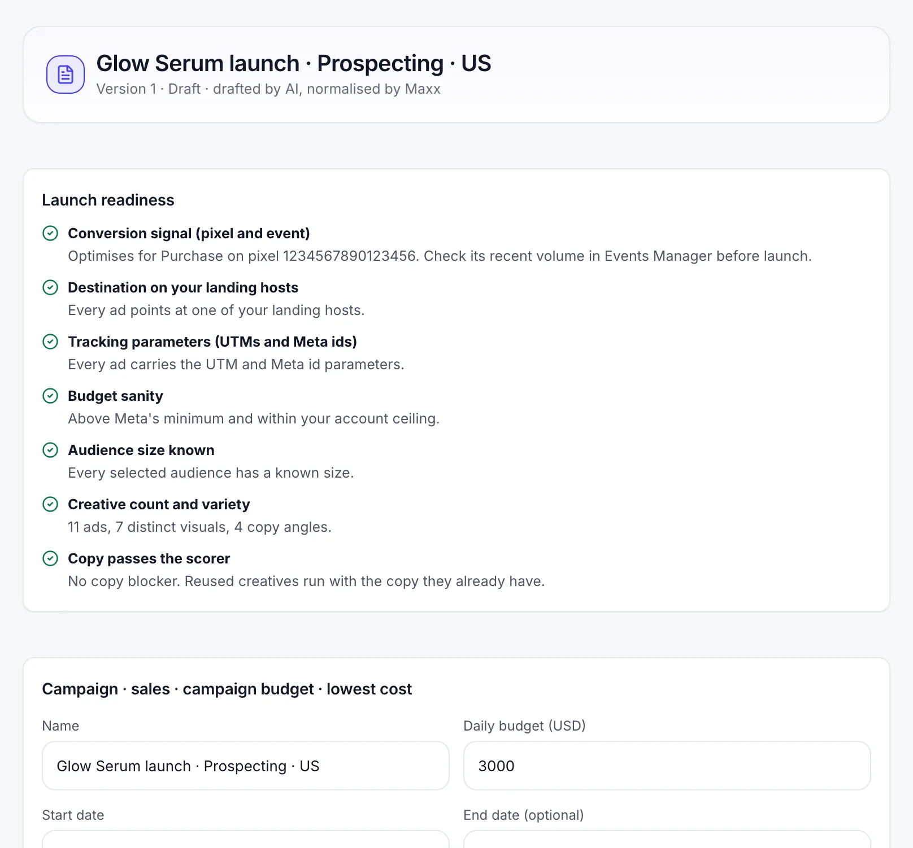
      </picture>
      <b>Plan and launch campaigns.</b> Describe the campaign; Maxx drafts the objective, CBO or ABO
      budget, ad sets with your own audiences, and ads that pair your existing creatives with scored
      copy. Every step is validated against your account, a launch-readiness checklist shows what is
      ready, and after you approve it the whole campaign is created in Meta <b>paused</b> and read back.
    </td>
    <td width="50%" valign="top">
      <picture>
        <source media="(prefers-color-scheme: dark)" srcset="docs/images/copy-studio-dark.webp">
        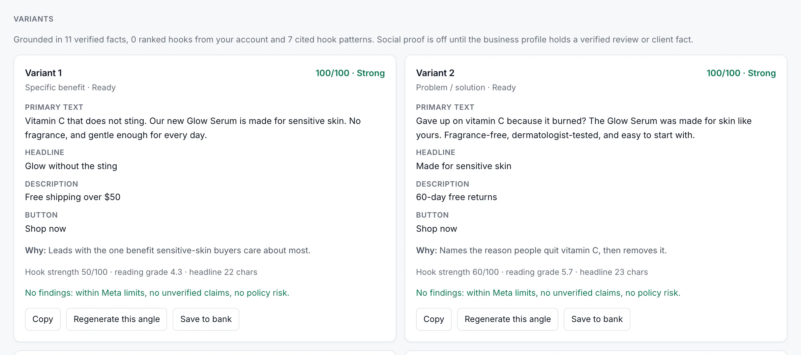
      </picture>
      <b>Write and score copy.</b> The Copy studio writes hooks, primary text, headlines and
      descriptions in your brand voice, grounded in facts you verified. Deterministic rules score
      every variant 0 to 100: Meta length limits, hook strength, readability, banned words, unverified
      claims, policy risk and near-duplicates. It scores the ads already running too, with AI off.
    </td>
  </tr>
  <tr>
    <td width="50%" valign="top">
      <picture>
        <source media="(prefers-color-scheme: dark)" srcset="docs/images/changes-approval-dark.webp">
        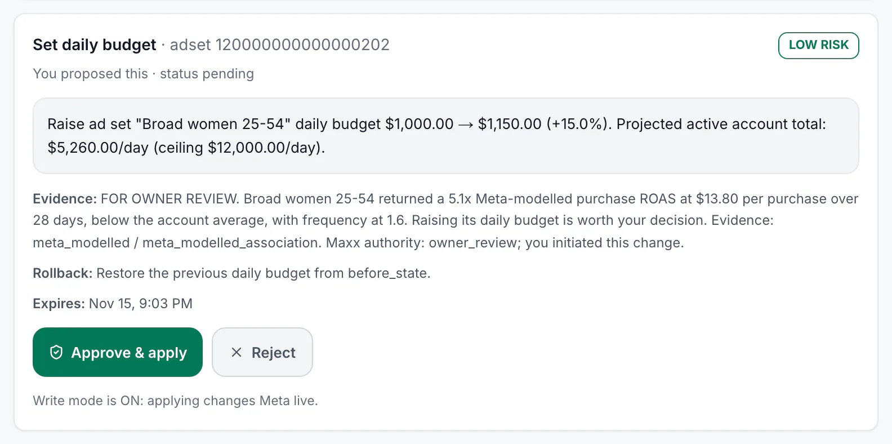
      </picture>
      <b>Decisions you approve.</b> Every recommendation comes with its evidence and authority tier.
      "Propose this change" turns one into an approval card with the exact preview, evidence, risk and
      rollback plan. Approve &amp; apply runs it under a per-account lock, verifies the result, and
      Roll back proposes the inverse change.
    </td>
    <td width="50%" valign="top">
      <picture>
        <source media="(prefers-color-scheme: dark)" srcset="docs/images/chat-audit-dark.webp">
        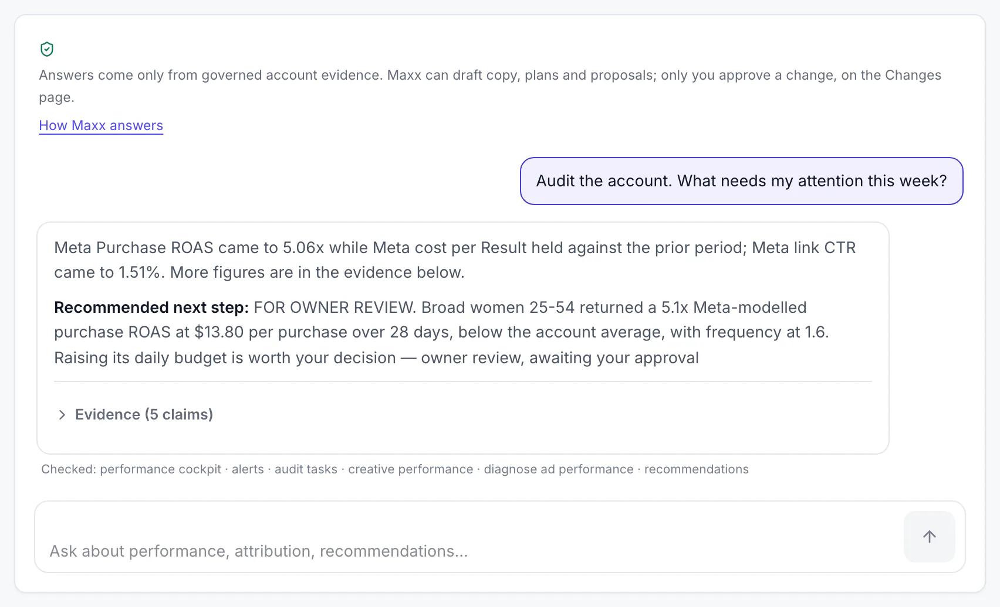
      </picture>
      <b>Audits and diagnosis.</b> Ask anything about the account. Answers lead with a plain-English
      summary and the recommended next step, with the evidence one click away. Behind them, a drop in
      results is split into its parts (fewer clicks or a worse rate, and which campaign drove it) next to
      learning-phase, delivery, quality-ranking, data-drift and tracking checks.
    </td>
  </tr>
  <tr>
    <td width="50%" valign="top">
      <picture>
        <source media="(prefers-color-scheme: dark)" srcset="docs/images/creative-dark.webp">
        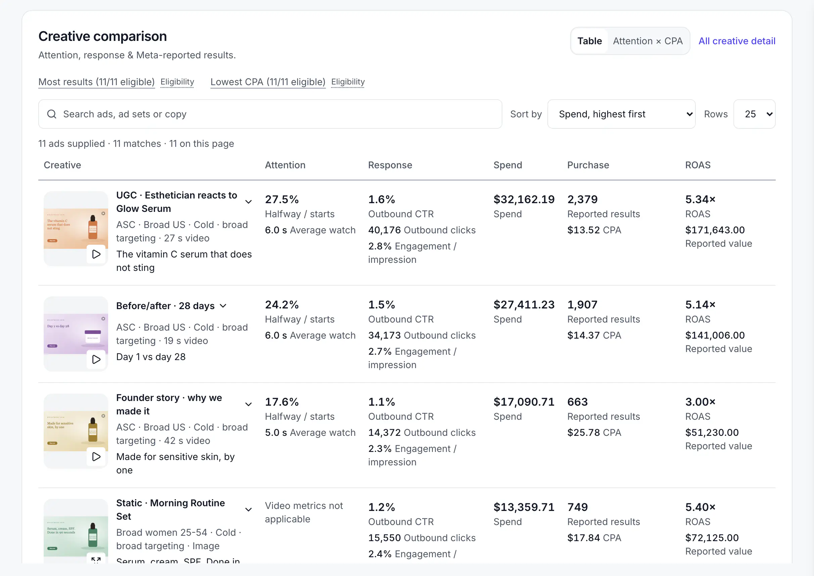
      </picture>
      <b>Creative intelligence.</b> Every ad side by side: hook and hold rates with the right
      denominators, watch time, outbound CTR, spend, CPA and ROAS, plus video retention, fatigue
      signals, format mix and the copy that ran, ranked by response.
    </td>
    <td width="50%" valign="top">
      <picture>
        <source media="(prefers-color-scheme: dark)" srcset="docs/images/audience-dark.webp">
        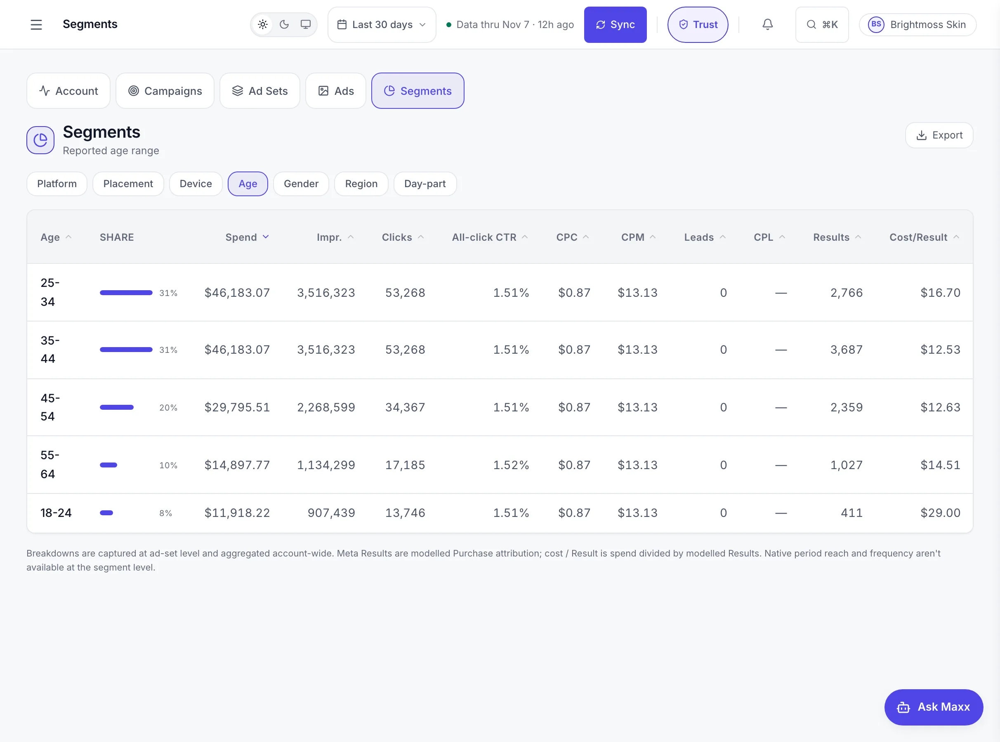
      </picture>
      <b>Audience and placement intelligence.</b> Spend and results by age, gender, platform,
      placement, device, region and time of day, and ad sets classified cold or warm from their real
      targeting, not their names.
    </td>
  </tr>
  <tr>
    <td width="50%" valign="top">
      <picture>
        <source media="(prefers-color-scheme: dark)" srcset="docs/images/reports-dark.webp">
        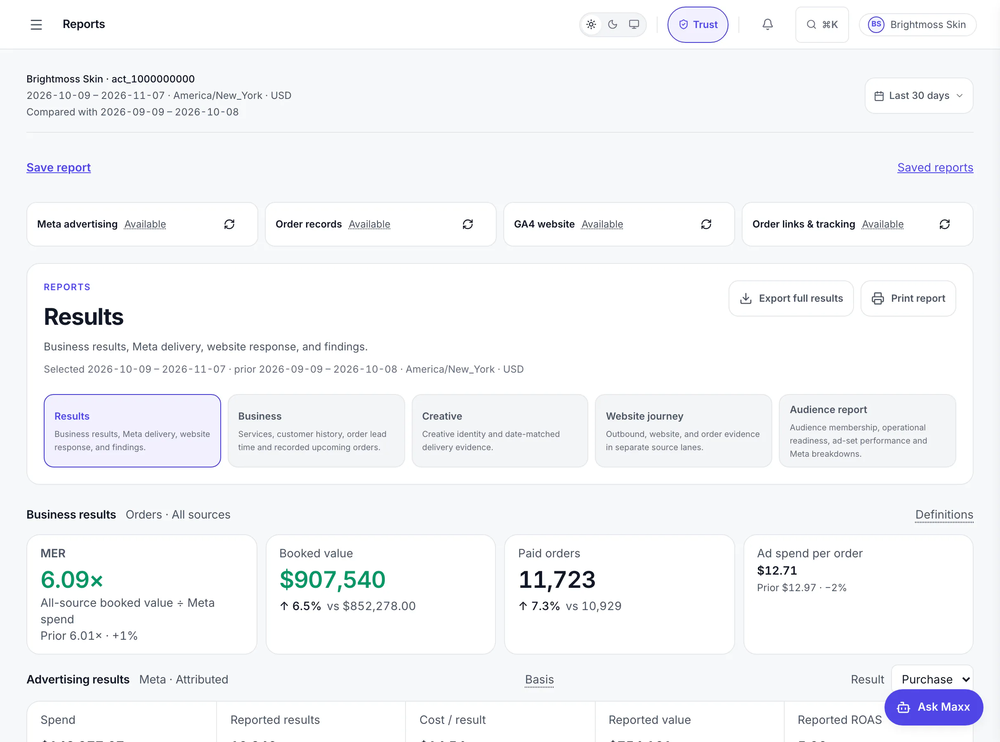
      </picture>
      <b>Reports and alerts.</b> Results, business, creative, website-journey and audience reports
      with CSV export and saved reports; a daily digest and a weekly executive email; alerts on every
      sync for spend, CTR, CPA, CPM and frequency, plus a midday pacing check.
    </td>
    <td width="50%" valign="top">
      <picture>
        <source media="(prefers-color-scheme: dark)" srcset="docs/images/launch-readiness-dark.webp">
        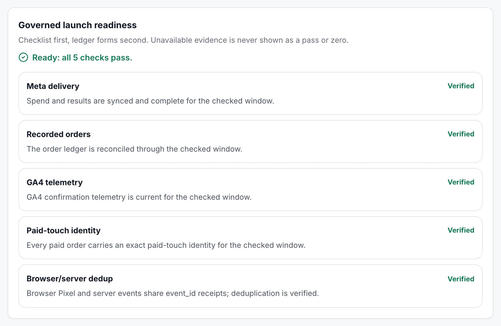
      </picture>
      <b>Attribution to real business outcomes.</b> Meta's modelled results sit beside the orders,
      leads or bookings your business recorded, never blended. Outcomes arrive by signed webhook, CSV
      or the Acuity adapter, and launch readiness checks that delivery, the outcome ledger and GA4 are
      all reporting before money goes out.
    </td>
  </tr>
  <tr>
    <td colspan="2" valign="top">
      <picture>
        <source media="(prefers-color-scheme: dark)" srcset="docs/images/diagnostics-dark.webp">
        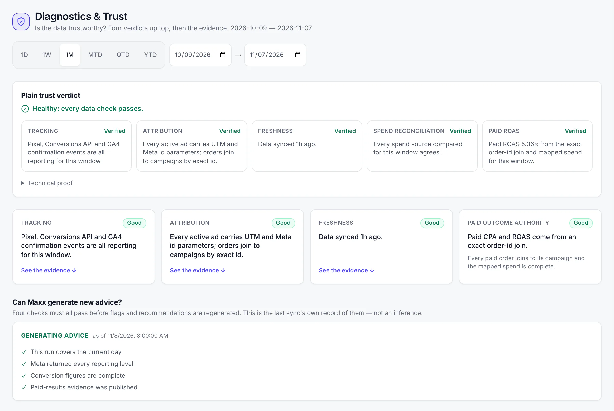
      </picture>
      <b>Diagnostics and trust.</b> One page answers whether the numbers can be trusted before you act
      on them: plain verdicts for tracking, attribution, freshness and spend reconciliation; the sync's
      own record of whether advice may be regenerated; a data-trust score; Meta, outcome and GA4 figures
      reconciled side by side; how many ads carry the parameters that trace credit to a campaign; and
      what changed since the prior period, split into its arithmetic driver and the campaign behind it.
    </td>
  </tr>
</table>

<p align="center">
  <picture>
    <source media="(prefers-color-scheme: dark)" srcset="docs/images/dashboard-dark.webp">
    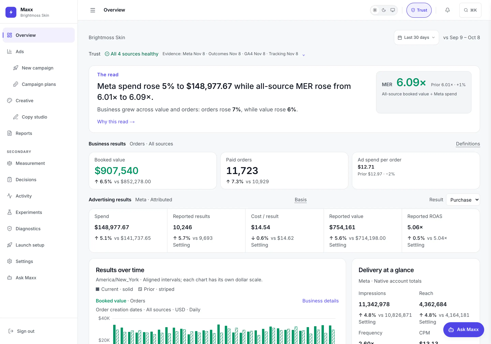
  </picture>
</p>

<p align="center"><b>The morning read:</b> Meta spend against all-source revenue (MER), orders and value from your own records, and Meta-reported results, side by side. And the rest of the agency:</p>

- **Competitor research.** Competitor Pages' ads from Meta's Ad Library, nightly snapshots, and
  longevity and format trends, presented as ideas to test, not proof. Meta's API limits what it
  returns ([details](docs/platforms.md#meta-ad-library-what-meta-returns)).
- **Conversions API.** Confirmed website outcomes can be sent back to Meta with deduplication, so
  Meta optimises on what your business recorded (off by default).
- **An MCP server.** 46 read-only tools, including campaign plans and a validated plan preview, so
  Claude Desktop or any MCP client can work the account with you.
- **AI optional.** One gateway over Claude (Anthropic API, Bedrock, Vertex, Foundry) and any
  OpenAI-compatible server. With `AI_PROVIDER=none`, every report, diagnostic, copy score and the
  template campaign planner still work.

## See it work

Ask Maxx in plain language. It answers questions from governed claims, and when you ask it to act it
runs one of three owner actions: write copy, draft a campaign plan, or propose a change it recommended.
Each action ends with a card that links to where you review it. **The chat never approves, applies or
submits anything.**

<p align="center"><b>"Draft a prospecting campaign for our new Vitamin C serum at $3,000/day"</b></p>

<p align="center">
  <picture>
    <source media="(prefers-color-scheme: dark)" srcset="docs/images/chat-plan-dark.webp">
    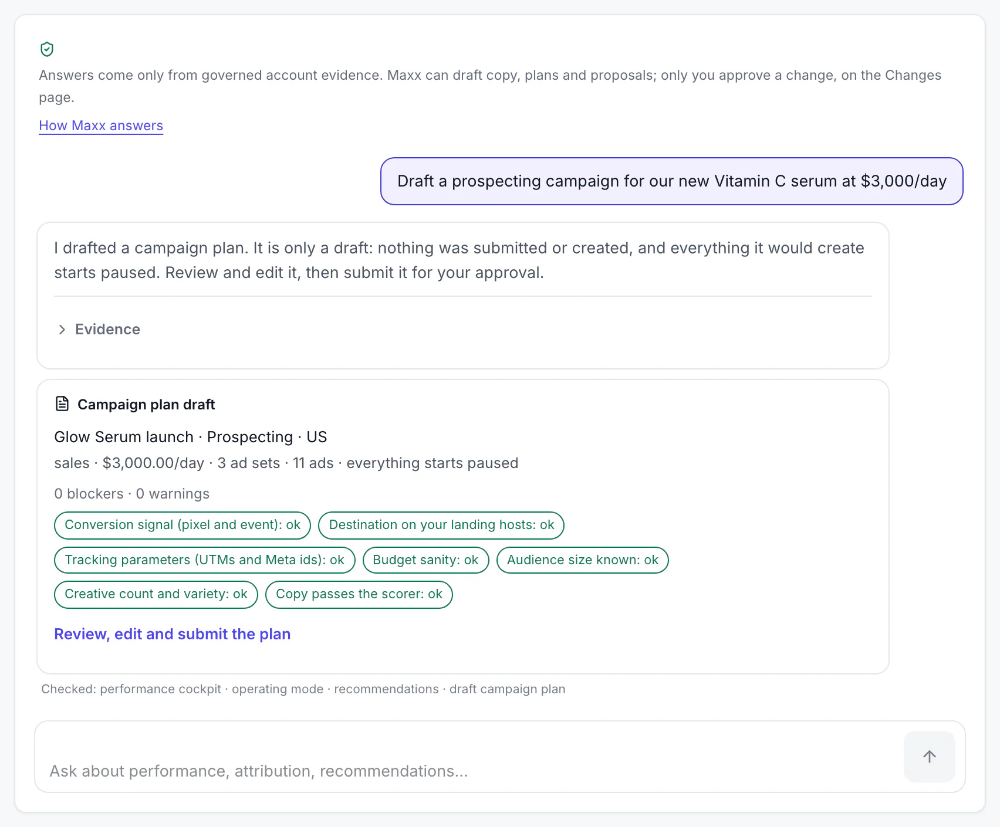
  </picture>
</p>

<p align="center"><b>"Write 5 hooks for our summer sale"</b></p>

<p align="center">
  <picture>
    <source media="(prefers-color-scheme: dark)" srcset="docs/images/chat-copy-dark.webp">
    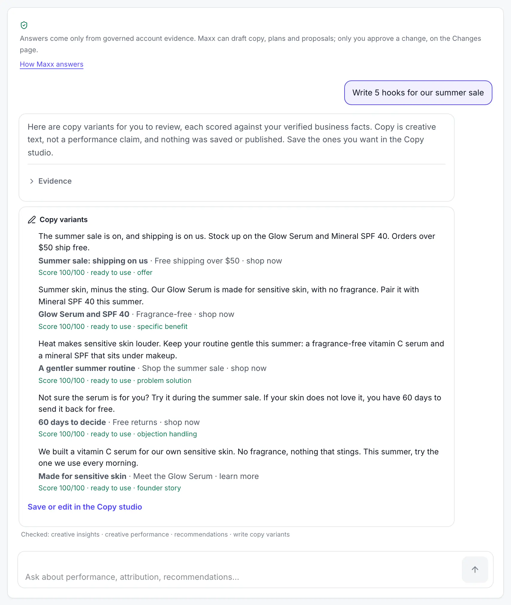
  </picture>
</p>

<p align="center"><b>"Propose the budget change you recommended for Broad women 25-54: $1,150 a day"</b></p>

<p align="center">
  <picture>
    <source media="(prefers-color-scheme: dark)" srcset="docs/images/chat-approval-dark.webp">
    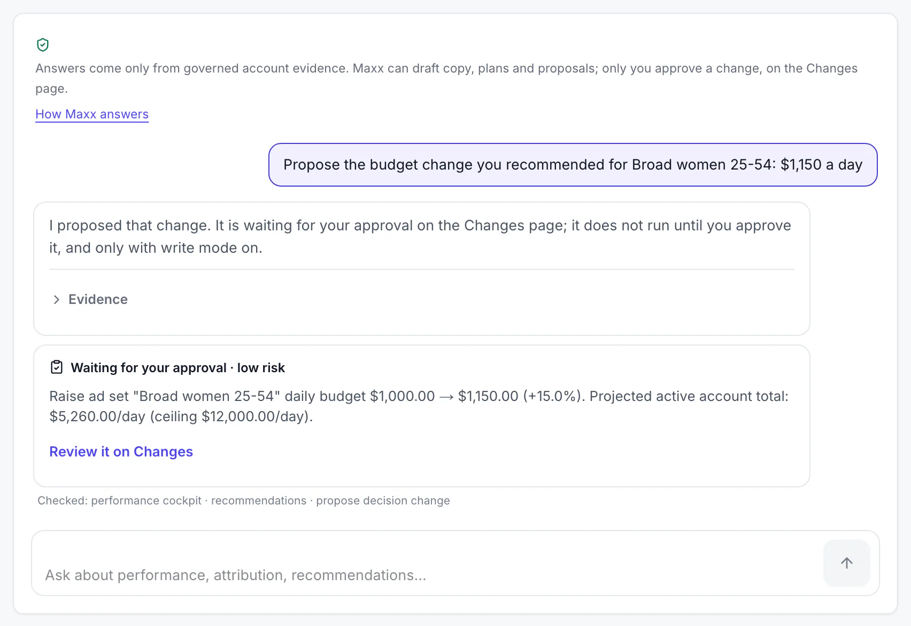
  </picture>
</p>

<p align="center"><b>Approve &amp; apply on Changes: created paused, verified</b></p>

<p align="center">
  <picture>
    <source media="(prefers-color-scheme: dark)" srcset="docs/images/changes-result-dark.webp">
    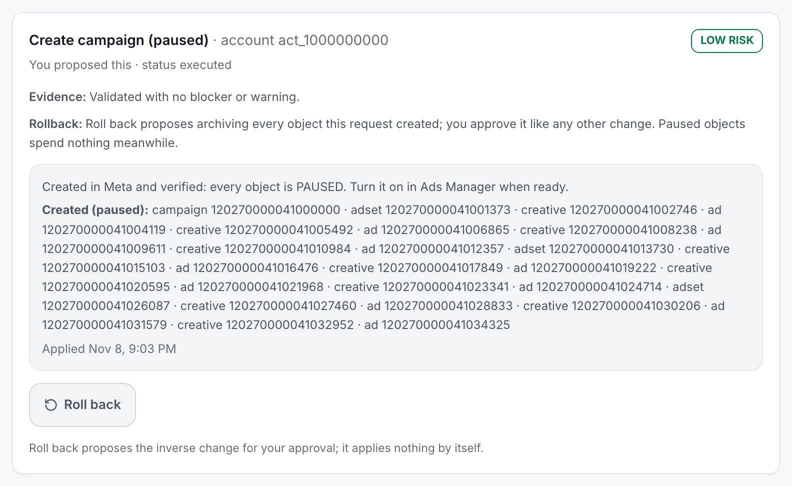
  </picture>
</p>

<details>
<summary>What an answer is made of</summary>

The model may only **select** governed claims and stored decisions by id; the server writes the
summary and renders every number with its window, scope, source, measurement lane, authority,
maturity and freshness. If a number cannot be verified, the answer says what blocked it instead of
guessing. One claim from the audit above:

```text
Meta Purchase ROAS — 5.06x
  2026-10-09 to 2026-11-07 America/New_York; scope: account act_1000000000
  source: meta; measurement lane: derived; authority: authoritative; availability: available;
  maturity: settling; attribution: Meta modelled; freshness: fresh
```

Copy in a card already passed the scorer and the unverified-claim detector. A plan draft needs your
budget and countries (the chat asks rather than guesses), and a proposal needs a stored decision shown
in that conversation. The chat needs an AI provider (`MAXX_CHAT_ENABLED=true` plus `AI_PROVIDER`).
The rules: [docs/how-maxx-decides.md](docs/how-maxx-decides.md).
</details>

### Safe by design

- **Nothing changes without your approval.** Writes are off unless `WRITE_MODE_ENABLED=true`, and
  even then each change is a request you approve on the Changes page, with an expiry, an idempotency
  key, a per-account lock, the account budget ceiling (`DAILY_BUDGET_CEILING`) and a per-change step
  limit (`MAX_BUDGET_CHANGE_PERCENT`).
- **Campaigns are created paused.** The payload builder cannot emit an active status; every object is
  read back after creation, anything that reads as active is paused again, and a partial failure can
  be resumed without duplicates or rolled back by archiving what was created.
- **Every number has evidence.** Money, counts and attribution are deterministic code; the model never
  computes a number, picks a budget or chooses a bid.

## Quickstart

No accounts, no secrets, sample data for a fictional business:

```bash
git clone https://github.com/geovannig1/maxx-ai-media-buyer.git maxx
cd maxx
npm ci
npm run demo
```

Open http://127.0.0.1:3000. You are signed in as the fictional owner. The demo runs with AI off,
never reads your `.env.local` and has no connection to Meta. It uses ports 3000 to 3003; if one is
taken, it says which, and `npm run demo -- --port 4000` moves it to 4000 to 4003.

## Install

You need Node.js 24, a Supabase project, a Meta System User token with `ads_read` for one ad account,
and one owner email. Outcome sources, AI, GA4 and email can be added later; changes and campaign
creation need `ads_management` and `WRITE_MODE_ENABLED=true`. Until the configuration is complete, the
app opens a setup checklist (`/setup`) instead of the dashboard.

**Locally:**

```bash
npm run setup
npm run doctor
npm run dev
```

`npm run setup` asks for what is needed, validates it, writes `.env.local` (mode 600), generates the
internal secrets and creates the owner user. `npm run doctor` re-runs the checks at any time. Without a
hosted Supabase project, `npm run setup -- --local` starts a local one with Docker and writes its URL
and keys for you; sign-in links then arrive in its Mailpit inbox at http://127.0.0.1:54324
([docs/install.md](docs/install.md#3-supabase), which also covers troubleshooting).

### Deploy to Vercel

[](https://vercel.com/new/clone?repository-url=https%3A%2F%2Fgithub.com%2Fgeovannig1%2Fmaxx-ai-media-buyer&env=NEXT_PUBLIC_SUPABASE_URL,NEXT_PUBLIC_SUPABASE_ANON_KEY,SUPABASE_SERVICE_ROLE_KEY,OWNER_EMAIL,CRON_SECRET,META_ACCESS_TOKEN,META_AD_ACCOUNT_ID&envDescription=Supabase%20project%2C%20owner%20email%2C%20a%2032%2B%20character%20cron%20secret%2C%20and%20a%20Meta%20System%20User%20token%20with%20ads_read%20for%20one%20ad%20account.%20Open%20%2Fsetup%20after%20deploying%20for%20the%20full%20checklist.&envLink=https%3A%2F%2Fgithub.com%2Fgeovannig1%2Fmaxx-ai-media-buyer%2Fblob%2Fmain%2Fdocs%2Fconfiguration.md&project-name=maxx&repository-name=maxx)

The button asks for the required variables (`NEXT_PUBLIC_SUPABASE_URL`, `NEXT_PUBLIC_SUPABASE_ANON_KEY`, `SUPABASE_SERVICE_ROLE_KEY`, `OWNER_EMAIL`, `CRON_SECRET`, `META_ACCESS_TOKEN`, `META_AD_ACCOUNT_ID`).
Apply the database schema to your Supabase project first (`npm run setup -- --apply-schema`, or
`npx --yes supabase@2.109.1 db push`), then open `/setup` on the deployment.

After the first deploy, also set in the Vercel project (then redeploy, because `NEXT_PUBLIC_*` values
are built into the bundle):

- `NEXT_PUBLIC_ACCOUNT_TIMEZONE` and `NEXT_PUBLIC_ACCOUNT_CURRENCY` to the ad account's own timezone
  and currency. Reports refuse a mismatch rather than mix two calendars or currencies.
- `META_APPSECRET_PROOF_ENABLED=true`, together with **"Require App Secret"** in the Meta app's
  Advanced settings, so every Graph call carries `appsecret_proof`
  ([docs/install.md](docs/install.md)).
- `APP_URL` only if you serve the app on a custom domain that is not the production domain.

**Self-hosted elsewhere:** `npm run build` and `npm run start` on Node 24 behind HTTPS, plus a
scheduler that calls the two job URLs, and `APP_URL` set to the URL your browser uses (without it,
sign-in redirects point at `localhost` and changes are refused as cross-origin)
([docs/install.md](docs/install.md#10-self-hosting-elsewhere)).

The complete walkthrough, with a check after every step: [docs/install.md](docs/install.md).

## Works for any business

Maxx counts what your business calls a result. You name it (`NEXT_PUBLIC_OUTCOME_NOUN`), pick the
Meta event that marks it (`NEXT_PUBLIC_META_OUTCOME_EVENT`) and connect a source
([docs/outcomes.md](docs/outcomes.md)):

| Business | Outcome source | What Maxx compares |
|---|---|---|
| Med spa or local service | The Acuity Scheduling adapter, or your booking system's signed webhook | Booked and paid appointments against Meta-reported bookings and spend |
| Online store | An order webhook from your storefront (`sale`), or a CSV of orders | Orders, revenue and MER against Meta-reported purchases and ROAS |
| B2B SaaS | A CRM export as CSV, or a webhook per demo request (`lead`, `quote`) | Qualified demos against Meta-reported leads and cost per lead |

## Architecture

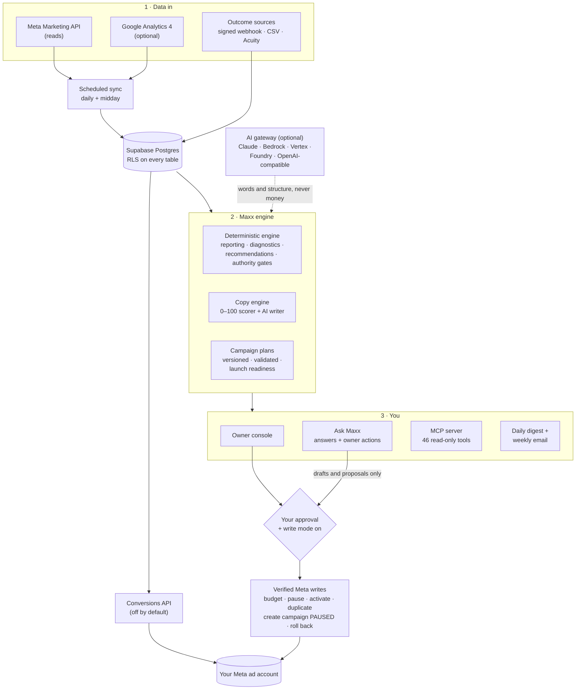

- **Meta platform adapter** (`src/lib/platforms/meta`): Graph API reads for entities, insights,
  breakdowns, pacing, the Ad Library and tracking health, plus the campaign-creation transport
  (`src/lib/platforms/meta/campaign-writes.ts`), behind a platform interface
  (`src/lib/platforms/types.ts`) that a second ad platform implements ([docs/platforms.md](docs/platforms.md)).
- **Outcome sources** (`src/lib/outcomes`): one outcome model for orders, leads and bookings, written
  by the signed webhook, the CSV import and the Acuity adapter.
- **Sync and database** (`src/lib/sync`, `src/app/api/cron/daily-sync`, `supabase/migrations`): the
  daily sync and midday pacing check, called by any scheduler with `CRON_SECRET`, into one baseline
  schema with Row Level Security on every table and no grants to the browser roles.
- **Deterministic engine** (`src/lib/reporting`, `src/lib/diagnostics`, `src/lib/recommendations`,
  `src/lib/authority`): money, counts, deduplication, attribution and authority gates as plain,
  tested code.
- **Copy engine** (`src/lib/creative/copy-scorer.ts`, `src/lib/creative/copy-generator.ts`): the
  0 to 100 scorer that runs with no model, and one structured AI call whose output is validated,
  de-duplicated and scored before you see it ([ADR-061](docs/architecture/adr-061-ai-copy-engine.md)).
- **Campaign plans** (`src/lib/campaigns`): immutable, versioned plans; deterministic validation and
  the launch-readiness checklist; the AI and template planners; and the executor that creates every
  object paused, records it, reads it back and can resume or archive
  ([ADR-062](docs/architecture/adr-062-campaign-plans.md)).
- **Writes and approvals** (`src/lib/writes`, `/changes`): the only path that changes the ad account:
  owner proposals, Approve &amp; apply, verification, audit and rollback
  ([ADR-059](docs/architecture/adr-059-owner-initiated-changes.md)).
- **AI gateway** (`src/lib/ai`): one interface over Claude (Anthropic API, Bedrock, Vertex, Foundry)
  and any OpenAI-compatible server; `AI_PROVIDER=none` turns every AI feature off ([docs/ai.md](docs/ai.md)).
- **Ask Maxx** (`src/lib/maxx`): a tool-using chat whose answers the server renders from the governed
  claims the model selected, and whose three owner actions (`src/lib/maxx/chat-actions.ts`) end in a
  card, never an approval.
- **Owner console** (`src/app`, `src/components`): Next.js 16 server components behind a
  single-owner gate.
- **MCP server** (`src/mcp`): a stdio server exposing the same read-only tools to Claude Desktop or
  any MCP client.
- **Conversions API** (`src/lib/capi`): sends confirmed website outcomes to Meta with a dedup event id.

## Engineering highlights

- **Tested like money depends on it:** more than 8,500 unit tests (Vitest), 900 database tests that
  run against the shipped schema in PGlite, and about 180 real-Postgres integration tests (Docker and
  the Supabase CLI). Tests carry controls, so a check must reject a planted bad case as well as accept a
  good one, and `npm run mutate` mutation-tests the guards.
- **CI on every push:** ESLint with zero warnings allowed, type checks for the app and the MCP
  server, unit and database tests, a production build, a migration replay with real-Supabase
  integration proofs, a demo run in a real browser, CodeQL, gitleaks secret scanning and a
  dependency audit.
- **No model in the money path:** spend, revenue, CPA, ROAS, MER, budgets and attribution are computed
  by deterministic code. In chat the model selects claim ids; in plans it proposes structure only; the
  server renders every number and sets every budget, objective and status.
- **Approval-gated, verified writes:** each change is an owner-approved request with a dry-run preview,
  an idempotency key, one executing action per account, a re-read of the approved state, before and
  after verification and an audit record. Campaign creation is retry-safe: each object is recorded
  before its Meta call and carries a marker in its name, so a resume never duplicates.
- **A written security model:** RLS on every table with nothing granted to the browser roles, a
  per-request nonce Content-Security-Policy with `strict-dynamic`, HttpOnly session cookies, an
  owner-only gate, HMAC-signed webhooks with timestamp tolerance and replay protection, same-origin
  checks on every mutation, and SSRF guards on fetched feeds ([docs/security-model.md](docs/security-model.md)).
- **Pluggable AI that can be switched off:** five provider options behind one gateway, and every
  report, diagnostic, copy score and template plan works with AI off.
- **Correct across currencies and timezones:** every business date uses the ad account's timezone,
  budgets are converted through the platform's minor units, and a currency or timezone mismatch is
  refused, never silently mixed.
- **Decisions on the record:** [docs/how-maxx-decides.md](docs/how-maxx-decides.md) for the evidence
  rules and [docs/architecture/overview.md](docs/architecture/overview.md) for the decision records.

## Tech stack

- **Next.js 16, React 19 and TypeScript (strict):** the console, API routes, scripts and MCP server
- **Supabase (Postgres and Auth):** warehouse, outcome ledger, campaign plans and sign-in, with RLS
- **Tailwind CSS 4, Base UI and shadcn:** the interface, with **Zod** validation at every boundary
- **Model Context Protocol SDK, Anthropic SDKs and an OpenAI-compatible adapter:** the MCP server and the optional AI gateway
- **Google Analytics Data API and Sentry:** optional web telemetry and error monitoring
- **Vitest, PGlite and Playwright:** unit, database and browser tests

## Roadmap

Built today and planned next. Items in the **Next** column do not exist yet.

| Area | Today | Next |
|---|---|---|
| Ad platforms | Meta (Facebook and Instagram) | Google Ads, TikTok and LinkedIn, on the existing platform interface (`src/lib/platforms`) |
| Campaigns | AI or template plans with validation and launch readiness, created paused after your approval, resumable, rolled back by archiving | Launching variants as structured tests |
| Ad copy | Copy studio: AI-written variants in your brand voice, deterministic 0 to 100 scoring, copy bank, scores for running ads | Learning score weights from delivered results |
| Creative | Creative analytics, retention and fatigue signals; plans reuse images and videos already in the account | AI image and video creative generation |
| Testing | Diagnostics and observed associations, labelled as such | Designed A/B and lift experiments with measured readouts |
| Attribution | Exact ad-click to outcome linking for Acuity; webhook and CSV outcomes keep click ids and UTMs | Exact linking for webhook and CSV outcomes |

## Limits, and what Maxx is not

- **One owner, one ad account per install.** No teams, roles, SSO or multi-tenant hosting. The
  service-role key is the whole authorization boundary; read
  [docs/security-model.md](docs/security-model.md) before deploying anywhere public.
- **Meta only** today. The platform interface exists; a second platform is not built ([docs/platforms.md](docs/platforms.md)).
- **Not an autopilot.** It never changes your ads on its own and never activates a campaign.
- **Not an attribution oracle.** Without a designed experiment it reports association and says so;
  it does not claim which ad caused a sale.
- **No currency conversion.** Reports use the ad account's currency and timezone and refuse a
  mismatch.
- **Competitor discovery is limited by Meta:** Meta's public Ad Library API returns only political
  and social-issue ads, plus ads delivered in the EU and UK
  ([details](docs/platforms.md#meta-ad-library-what-meta-returns)).

## Documentation

| Document | What it covers |
|---|---|
| [docs/install.md](docs/install.md) | Supabase, owner, Meta, AI, outcome sources, Vercel and self-hosting, each with a check |
| [docs/configuration.md](docs/configuration.md) | Every environment variable, generated from the schema (`npm run env:docs`) |
| [docs/outcomes.md](docs/outcomes.md) | The outcome model, CSV format, signed webhook with examples in three languages, writing an adapter |
| [docs/how-maxx-decides.md](docs/how-maxx-decides.md) | Evidence rules, authority gates, changes you approve, campaign plans, the role of AI |
| [docs/ai.md](docs/ai.md) | AI providers, defaults and their cost, AI-off mode, what is sent |
| [docs/platforms.md](docs/platforms.md) | The ad-platform interface and adding a platform |
| [docs/operations.md](docs/operations.md) | Jobs, backups, upgrades, secret rotation, monitoring, incidents |
| [docs/security-model.md](docs/security-model.md) | Threat model, authorization boundary, deployment checklist |
| [docs/architecture/overview.md](docs/architecture/overview.md) | Architecture overview and decision records |
| [CHANGELOG.md](CHANGELOG.md) | Release notes |
| [CONTRIBUTING.md](CONTRIBUTING.md) | Development setup, tests, proposing an adapter or platform |
| [SECURITY.md](SECURITY.md) | Reporting a vulnerability |
| [THIRD_PARTY_NOTICES.md](THIRD_PARTY_NOTICES.md) | Licenses of production dependencies |

## Contributing

```bash
npm run gate
npm run gate:full
npm run test:watch
```

`npm run gate` runs lint, both type checks, unit tests (including the docs smoke test), PGlite
database tests and a production build, with no secrets; CI runs the same steps. `npm run gate:full`
adds a migration replay and real-Postgres proofs (Docker and the Supabase CLI) and **drops and
rebuilds the local database schema**. New outcome-source adapters and ad platforms are especially
welcome: [CONTRIBUTING.md](CONTRIBUTING.md). Report vulnerabilities privately: [SECURITY.md](SECURITY.md).

## License

Apache License 2.0. See [LICENSE](LICENSE) and [THIRD_PARTY_NOTICES.md](THIRD_PARTY_NOTICES.md).

- `docs/meta-knowledge/` is vendored from [mathiaschu/meta-ads-analyzer](https://github.com/mathiaschu/meta-ads-analyzer)
  under the MIT License (see `docs/meta-knowledge/LICENSE`).
- `src/app/vendor/shadcn-tailwind.css` is vendored from the shadcn package (MIT License, Copyright (c) 2023 shadcn).

Meta, Facebook, Instagram, Acuity Scheduling, Google Analytics, Supabase and Vercel are trademarks of
their owners; this project is not affiliated with or endorsed by any of them.

## Built by


Built by **Geovanni Granda** — Director of Software Engineering.<br>
[GitHub](https://github.com/geovannig1) · [LinkedIn](https://www.linkedin.com/in/geovannigranda1/)
